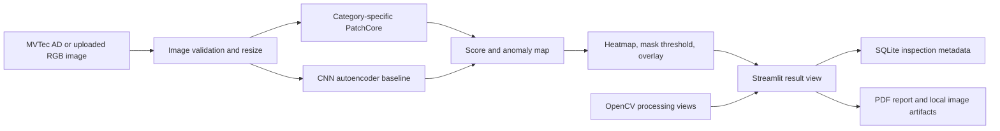
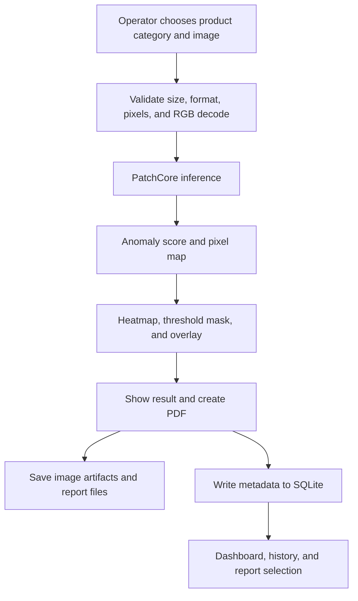
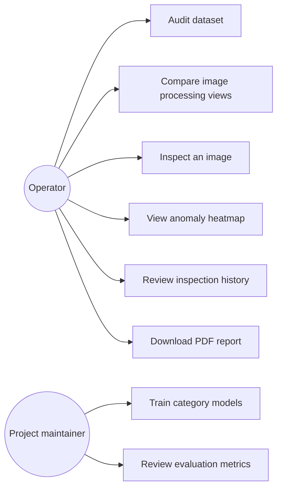

# IndustrialGuard AI Project Report

## Intelligent Industrial Defect Detection and Anomaly Localization

**Academic areas:** Image Processing and Analysis, Deep Learning, Neural Networks  
**Project type:** Local academic mini-project  
**Implementation:** Python, PyTorch, Anomalib, OpenCV, Streamlit, SQLite  
**Dataset:** complete MVTec Anomaly Detection (MVTec AD), 15 categories

## Abstract

IndustrialGuard AI is a local visual-inspection prototype for detecting unusual product appearance and highlighting suspicious regions. It combines image-processing views with category-specific normal-only PatchCore anomaly detectors trained for all 15 MVTec AD categories, a compact convolutional autoencoder comparison, and a separate supervised detector for seven plastic-bottle defects. The system accepts an image, selects a model, displays anomaly heatmaps or labeled detection regions, and records PatchCore inspections with SQLite history and PDF reports. MVTec AD evaluation uses its official test split after training and threshold selection; the bottle detector uses the supplied PBD validation split.

In the expanded run, PatchCore image AUROC ranged from 0.643 to 1.000 across categories; pixel AUROC ranged from 0.931 to 0.993. Some thresholded localization F1 scores were low, so the AUROC values do not imply a reliable pixel threshold. CNN autoencoders were trained for seven categories as a secondary comparison and performed inconsistently. Results use one seed and a public benchmark; they do not establish factory readiness. Anomaly scores are not probabilities. Heatmaps show model output but do not prove its reasoning.

## 1. Introduction and Background

Visual inspection is used to find scratches, cracks, dents, contamination, missing pieces, and other manufacturing defects. Manual inspection can be slow and inconsistent. A vision system can help by comparing an observed product with the appearance of defect-free products and highlighting regions that differ.

Industrial anomaly detection is useful when defective examples are rare or varied. In MVTec AD, training images are defect-free, while the test split contains both normal and defective images with pixel-level masks for abnormal regions. This makes it possible to study both image-level decisions and pixel-level localization without training a conventional classifier on the official test defects.

## 2. Problem Statement

Given an RGB image and a selected product category, the system must determine whether its appearance is consistent with the normal training examples. It must return an anomaly score, a normal/defective decision, and a heatmap that indicates where the image differs. The result must be recorded with its category, timestamp, model, processing time, and report path.

## 3. Objectives

1. Audit and load all 15 MVTec AD categories without mixing the official test split into training.
2. Demonstrate image loading, validation, resizing, smoothing, contrast enhancement, histograms, and edge detection.
3. Train a PatchCore model for each category using defect-free training images.
4. Train a compact convolutional autoencoder on normal images as an educational deep-learning baseline.
5. Evaluate image-level detection and pixel-level localization with a held-out test split.
6. Provide a Streamlit interface with an inspection dashboard, visualizations, history, and PDF reports.
7. Keep images and model files outside the SQLite database.
8. Train a separate labeled detector for plastic bottle body and shoulder defects.

## 4. Scope and Assumptions

The expanded prototype covers all 15 MVTec AD categories and runs locally on Windows with an NVIDIA RTX 4060 Laptop GPU. MVTec AD is a benchmark, not a substitute for images from a particular factory, camera, lighting setup, or production line. Only results calculated from the recorded runs are reported. The system is for academic demonstration and human review; it is not a certified safety or production-quality control system.

## 5. Dataset Selection

MVTec AD was selected because it follows the normal-only training setup required by PatchCore, contains multiple defect types, and supplies pixel-precise anomaly masks. The complete archive contains 5,354 images across 15 object and texture categories. The extracted dataset includes 3,629 defect-free training images, 467 normal test images, and 1,258 defective test images with 1,258 masks. The dataset is distributed under CC BY-NC-SA 4.0; its non-commercial terms must be respected.

| Dataset | Scale and content | Annotation and access | Fit for this mini-project |
|---|---|---|---|
| MVTec AD | 5,354 high-resolution images; 15 object/texture categories | Normal-only train, anomalous and normal test, pixel masks; CC BY-NC-SA 4.0; official download form | Selected: directly supports PatchCore and localization evaluation |
| VisA | 10,821 images from 12 object classes and 3 domains | Image and pixel labels; CC BY 4.0; AWS Open Data and research project resources | Good future extension; larger and more varied than the current benchmark |
| MVTec LOCO AD | 3,644 images in 5 categories; structural and logical anomalies | Pixel-precise anomaly regions; CC BY-NC-SA 4.0; official download | Valuable next benchmark for missing/incorrect object arrangements |
| KolektorSDD2 | 3,335 surface images, about 230 × 630 pixels; 356 defect images | Defect masks; CC BY-NC-SA 4.0; academic lab download | Useful for a focused surface-defect comparison but less varied in product type |
| DAGM 2007 | 16,100 synthetic grayscale texture images over 10 classes | Weak ellipse labels; competition download; confirm original terms before redistribution | Useful for texture-algorithm exercises, but synthetic images are less representative of this project |

The official MVTec AD and MVTec LOCO AD dataset pages provide the access and license terms. The official MVTec download page uses an access form; this machine's full archive download was about 5.26 GB. VisA and KolektorSDD2 have their own published access terms. Dataset images should not be redistributed with the source code. The downloaded MVTec archive and trained model checkpoints remain local and are excluded from the project deliverables.

## 6. Existing and Proposed Systems

The existing baseline is manual or rule-based inspection. Fixed thresholds and handcrafted filters can be effective in controlled scenes but usually require per-product tuning and can be sensitive to lighting or texture changes. A fully supervised defect classifier also needs representative labeled defects, which are often scarce.

The proposed system learns a reference model from normal examples. PatchCore stores representative feature patches extracted from a pretrained convolutional backbone. At inference time it compares test patches to the normal memory bank; large nearest-neighbor distances contribute to the anomaly score and localization map. The autoencoder comparison learns to reconstruct normal images and treats reconstruction error as an anomaly signal.

## 7. System Architecture

The current inference path in the interface uses category-specific PatchCore models for all 15 MVTec AD categories. The CNN autoencoder is a secondary training and evaluation comparison for selected categories. The local interface, dataset, and generated artifacts are kept simple: `app.py`, `src/industrialguard`, `scripts`, `data`, `results`, `artifacts`, `reports`, and `deliverables`.

### 7.1 Data flow

### 7.2 Use cases

## 8. Image Processing and Analysis

The app validates file type and size, decodes the input as RGB, and resizes it to the model's 256 × 256 input. Resizing is required by the model pipeline; it can remove small details, so production use should preserve and test a suitable resolution.

The Image Processing page compares the original with Gaussian smoothing, median filtering, CLAHE, Canny edges, and RGB channel histograms. These are demonstrations, not automatic transformations of the detector input. The model receives the original RGB image unless an experiment supports another preprocessing choice.

**Gaussian filtering** replaces each pixel with a weighted neighborhood average. A two-dimensional Gaussian kernel is proportional to `exp(-(x²+y²)/(2σ²))`. It suppresses high-frequency noise, but may soften small defects.

**Median filtering** sorts neighboring pixel values and uses the median. It removes isolated impulse noise while often preserving edges better than a mean filter; large kernels can erase small defects.

**CLAHE** divides the image into tiles, applies contrast-limited histogram equalization within each tile, and blends neighboring tiles. In this implementation CLAHE operates on the L channel in Lab color space. It can reveal local contrast, but may amplify noise.

**Canny edge detection** smooths the grayscale image, estimates gradient magnitude and direction, applies non-maximum suppression, and uses two thresholds with edge linking. It highlights boundaries and texture transitions but is not itself a defect classifier.

For a grayscale region with `L` possible intensity values and normalized histogram probabilities `pᵢ`, histogram entropy is `H = -Σ pᵢ log₂(pᵢ)`. Entropy can summarize texture complexity; the current app displays channel histograms but does not use histogram entropy as a model input.

## 9. Neural Networks and Deep Learning

### 9.1 Neural-network concepts

A neuron computes a weighted sum plus bias, `z = wᵀx + b`, followed by an activation such as ReLU, `max(0, z)`. A convolution layer applies shared kernels across an image to detect local patterns. Strided convolutions reduce spatial dimensions; batch normalization stabilizes intermediate activations. The autoencoder's decoder uses transposed convolutions to reconstruct an image.

During training, forward propagation produces a reconstruction. The mean squared error loss is `L = (1/N) Σ (xᵢ - x̂ᵢ)²`. Backpropagation computes gradients of this loss, and Adam updates weights using those gradients. The learning rate controls update size. Training/validation loss curves help detect underfitting or overfitting; the best checkpoint is selected by normal validation reconstruction loss.

### 9.2 CNN autoencoder

The implemented encoder has four convolution blocks with channel counts 32, 64, 128, and 256. Each block halves width and height. The decoder mirrors the encoder with transposed convolutions and returns a three-channel 256 × 256 image in [0, 1]. It is trained only on a seeded subset of defect-free training images. A held-out portion of those normal images selects the best checkpoint and derives score thresholds. At inference, per-pixel squared reconstruction error forms the anomaly map; its mean gives the image score.

An autoencoder is easy to connect to neural-network coursework and produces a natural reconstruction-error map. Its main weakness is that it may reconstruct an unusual defect well, or produce high error on normal texture. A small model is used to keep training practical on an 8 GB laptop GPU.

### 9.3 PatchCore

PatchCore uses a pretrained Wide ResNet-50 backbone, with intermediate `layer2` and `layer3` features. Local feature patches from normal training images form a representative memory bank; coreset selection reduces redundant stored patches. At inference, distances to nearest normal patches yield image scores and pixel anomaly maps. It is suitable for normal-only industrial datasets and does not require a labeled defect classifier. It uses pretrained features and a memory bank, so checkpoint size and inference memory are larger than the compact autoencoder.

## 10. Training and Evaluation Methodology

The PatchCore models are trained separately for each of the 15 categories, using the category's defect-free training images. Each validation set uses synthetic anomalies generated from training data. The official MVTec test split is reserved for final evaluation. Each autoencoder uses a deterministic 90/10 split of normal training images, trains on the 90% subset, selects its checkpoint using normal validation reconstruction loss, and sets thresholds using validation normal score distributions. Test images and masks are evaluated only after these choices are fixed.

Image AUROC measures how often a randomly selected defect receives a higher score than a randomly selected normal image across all thresholds. Average precision summarizes precision-recall performance and is helpful when positives are less common. Precision measures how many predicted defects are truly defective; recall measures how many defects are found. F1 is the harmonic mean of precision and recall. Pixel AUROC evaluates localization scores against defect masks over all thresholds. Pixel precision, recall, and F1 depend on a selected pixel threshold. AUPRO is a region-overlap measure designed to reduce the dominance of large normal backgrounds; it is not currently reported in the available baseline.

Timing is measured during inference after the model has loaded. It excludes process startup and checkpoint-loading time. Checkpoint bytes are reported from local files. GPU peak memory and images-per-second have not been measured in the current PatchCore report and are therefore left as future benchmarks rather than estimated.

## 11. Results and Discussion

### 11.1 Initial bottle and metal nut comparison

| Category | Model | Image AUROC | Image F1 | Pixel AUROC | Pixel F1 |
|---|---|---:|---:|---:|---:|
| Bottle | PatchCore | 1.000000 | 0.992000 | 0.985560 | 0.692171 |
| Bottle | CNN autoencoder | 0.709524 | 0.602151 | 0.629351 | 0.083983 |
| Metal nut | PatchCore | 0.998045 | 0.994595 | 0.987006 | 0.810754 |
| Metal nut | CNN autoencoder | 0.268328 | 0.039604 | 0.709168 | 0.012975 |

These values are the initial single-seed bottle and metal nut run. The expanded retraining results for all 15 PatchCore categories and the refreshed autoencoder comparison appear in section 11.3. The initial bottle pixel F1 is lower than AUROC, so thresholded localization still needs improvement. Figures and per-image score exports are in `reports/`.

The autoencoder confusion matrices are:

| Category | True negatives | False positives | False negatives | True positives |
|---|---:|---:|---:|---:|
| Bottle | 18 | 2 | 35 | 28 |
| Metal nut | 16 | 6 | 91 | 2 |

One normal bottle PatchCore sample scored 0.215387 and was labeled NORMAL. A broken-large bottle PatchCore sample scored 0.943801 and was labeled DEFECTIVE. A bent metal nut PatchCore sample scored 0.842154 and was labeled DEFECTIVE. Standalone PatchCore inference took about 1.16–1.20 seconds per image after model load.

### 11.2 Autoencoder comparison

The evaluation script writes metrics to `results/retrained/autoencoder/<category>_evaluation.json` and training curves to `results/retrained/autoencoder/<category>_training_curve.csv`. The extended run has completed autoencoder evaluations for seven categories; PatchCore was evaluated for all 15. A comparison across models is meaningful only when category, image size, split, threshold source, and test masks are stated. The normal-only validation percentile threshold differs from PatchCore's synthetic-validation threshold, so F1 values should be interpreted alongside AUROC, precision/recall, and the threshold policy.

### 11.3 Expanded all-category PatchCore results

All PatchCore models use seed 42 and the same Wide ResNet-50-2 backbone, `layer2` and `layer3` features, and nine nearest neighbors. The MVTec AD test split was used once for evaluation. Per-category results are also stored in `reports/retrained_patchcore_metrics.csv`.

| Category | Normal train images | Image AUROC | Image F1 | Pixel AUROC | Pixel F1 |
|---|---:|---:|---:|---:|---:|
| Bottle | 209 | 1.000000 | 0.992000 | 0.985560 | 0.692171 |
| Cable | 224 | 0.982571 | 0.923858 | 0.984730 | 0.377060 |
| Capsule | 219 | 0.992421 | 0.556291 | 0.989860 | 0.161669 |
| Carpet | 280 | 0.796549 | 0.880000 | 0.977072 | 0.091860 |
| Grid | 264 | 0.642857 | 0.844444 | 0.975794 | 0.033833 |
| Hazelnut | 391 | 1.000000 | 0.978102 | 0.988279 | 0.569998 |
| Leather | 245 | 1.000000 | 0.989247 | 0.992188 | 0.366212 |
| Metal nut | 220 | 0.998045 | 0.994595 | 0.987006 | 0.810754 |
| Pill | 267 | 0.939443 | 0.796610 | 0.981212 | 0.267940 |
| Screw | 320 | 0.956958 | 0.155039 | 0.988440 | 0.007586 |
| Tile | 230 | 0.969697 | 0.840000 | 0.948655 | 0.188165 |
| Toothbrush | 60 | 0.827778 | 0.461538 | 0.988795 | 0.526320 |
| Transistor | 213 | 0.993750 | 0.928571 | 0.973044 | 0.598765 |
| Wood | 247 | 0.990351 | 0.916031 | 0.931413 | 0.375661 |
| Zipper | 240 | 0.977679 | 0.975000 | 0.981382 | 0.459058 |

The benchmark shows that strong image AUROC does not guarantee a useful operating threshold: screw and grid have low pixel F1, and screw has low image F1 despite 0.957 image AUROC. These results support per-category threshold tuning on validation data and additional localization evaluation. They do not justify applying a single threshold across categories.

| Autoencoder category | Image AUROC | Image F1 | Pixel AUROC | Pixel F1 |
|---|---:|---:|---:|---:|
| Bottle | 0.700000 | 0.586957 | 0.633401 | 0.083671 |
| Cable | 0.500187 | 0.042553 | 0.507013 | 0.013555 |
| Capsule | 0.571998 | 0.018182 | 0.802050 | 0.119205 |
| Carpet | 0.339486 | 0.368000 | 0.539724 | 0.035770 |
| Grid | 0.838764 | 0.371429 | 0.676203 | 0.083995 |
| Hazelnut | 0.871786 | 0.494624 | 0.923833 | 0.465893 |
| Metal nut | 0.267840 | 0.039604 | 0.705878 | 0.012861 |

The autoencoder was not evaluated for all 15 categories in this expanded run. Its complete per-category results are in `reports/model_comparison.csv` and individual JSON files. The CNN baseline remained weaker and less consistent than PatchCore on the selected comparison categories.

## 12. Application and Data Storage

The Streamlit app provides Dashboard, Dataset Audit, Image Processing, AI Defect Detection, Inspection History, Reports, and Model Setup pages. The detection selector supports all 15 trained PatchCore categories and a separate supervised plastic-bottle detector. AI Defect Detection accepts uploads or a camera snapshot; each newly captured photo runs through the selected model automatically. SQLite stores metadata only for PatchCore inspections: ID, UTC time, category, filename, model, score, label, duration, and artifact paths. Original images, heatmaps, overlays, and PDF files are saved as local files under `artifacts/`; binary image data is not stored in database rows.

### 12.1 Supervised plastic-bottle defect detector

To extend the benchmark models with a labeled product detector, a Faster R-CNN MobileNetV3-FPN model was trained on the public Plastic Bottle Dataset (PBD). It combines the dataset's body and shoulder partitions into seven labels: body stain, concave, score and squeeze; shoulder pipe, no-burr and stain. Training used all 3,170 labeled images for three epochs on CUDA. Evaluation used the supplied 793-image validation split; no independent test partition is provided in the downloaded data. Validation mAP@0.50 was 0.355. Per-class AP@0.50 was 0.042 (body stain), 0.065 (body concave), 0.080 (body score), 0.202 (body squeeze), 1.000 (shoulder pipe), 0.967 (shoulder no-burr), and 0.129 (shoulder stain). The strong shoulder scores and weak body/stain results show uneven performance; this is an experimental baseline, not a validated production detector.

The checkpoint is `results/retrained/pbd_bottle_detector/pbd_bottle_defect_detector.pt`; training metrics are in `results/retrained/pbd_bottle_detector/pbd_bottle_evaluation.json`. The Streamlit AI Defect Detection page exposes this as a separate model choice and displays detected regions and raw confidence scores. The detection score is not calibrated, and these inspection outputs are not added to the PatchCore history/PDF workflow. The dataset is marked for academic use; its terms must be reviewed before any non-academic use.

The upload boundary rejects files over 10 MB, limits images to 16 megapixels, restricts accepted formats, and converts valid images to RGB. Exceptions from image decoding and model inference are shown to the user. The app is local-only and has no login or multi-user access control; it should not be exposed to the public internet in this configuration.

## 13. Advantages

- Learns normal appearance without requiring a training set of every defect type.
- Produces both image-level anomaly decisions and localized heatmaps.
- Demonstrates classical image processing and neural feature learning in one application.
- Keeps category models separate and preserves the official test protocol.
- Creates a reviewable local inspection history and PDF reports.

## 14. Limitations

- Test results use one seed on a public benchmark; they do not guarantee performance on a real factory line.
- PatchCore image and pixel metrics vary widely by category. The low grid/screw F1 values need threshold and localization improvements.
- Autoencoder comparison is available for seven of 15 categories, not the full benchmark.
- The anomaly score is not a probability or calibrated confidence.
- Heatmaps are approximate local anomaly scores; they are not causal explanations.
- The bottle pixel F1 indicates that thresholded localization needs improvement.
- The PBD detector is uneven across defect types, and its reported score is from the supplied validation split rather than an independent production test.
- No labeled metal-bottle, cold-drink bottle design, snack-packet packaging, or industrial cable dataset was trained here. The MVTec bottle/cable PatchCore models are limited to their benchmark product designs.
- The image upload flow was exercised through the project inference/report pipeline with local test images; browser file-picker automation could not be verified in this session.
- Continuous video-stream inspection, batch workflow, authentication, cloud database, or deployment has not been implemented.
- Dataset license is non-commercial; do not use these images commercially without permission.

## 15. Future Work

1. Verify browser upload using the normal file picker and add invalid-image interface checks.
2. Expand autoencoder evaluation to the remaining eight categories and compare thresholds with confusion matrices and ROC curves.
3. Measure peak VRAM, checkpoint-load time, steady-state latency, and throughput.
4. Evaluate additional preprocessing only as controlled ablations; never select a transform using the official test set.
5. Add more categories or evaluate VisA/MVTec LOCO AD as a separate benchmark.
6. Add a batch-inspection mode only after single-image UI behavior is stable.
7. For deployment, use a private local workstation or a CPU-friendly hosted demo; do not assume a free cloud tier has GPU access. Store credentials in environment variables and weights outside a public source repository.

## 16. Conclusion

IndustrialGuard AI implements a local academic prototype that integrates image processing, normal-only PatchCore anomaly detection across all 15 MVTec categories, a compact CNN autoencoder comparison, a separately trained seven-label plastic-bottle detector, localized visual outputs, SQLite history, and PDF reporting. The expanded results show both strong benchmark rankings and weak thresholded localization or uneven defect detection. The results and limitations are reported without treating any score as a probability or the heatmap as proof. The system is a reproducible demonstration and requires additional evaluation on production-specific data before operational use.

## 17. References

1. P. Bergmann, M. Fauser, D. Sattlegger, and C. Steger, “MVTec AD — A Comprehensive Real-World Dataset for Unsupervised Anomaly Detection,” CVPR, 2019. [Paper](https://www.mvtec.com/fileadmin/Redaktion/mvtec.com/company/research/datasets/mvtec_ad.pdf). [Official dataset and license page](https://www.mvtec.com/research-teaching/datasets/mvtec-ad).
2. K. Roth, L. Pemula, J. Zepeda, B. Schölkopf, T. Brox, and P. Gehler, “Towards Total Recall in Industrial Anomaly Detection,” CVPR, 2022, pp. 14318–14328. [Paper](https://openaccess.thecvf.com/content/CVPR2022/html/Roth_Towards_Total_Recall_in_Industrial_Anomaly_Detection_CVPR_2022_paper.html).
3. J. Batzner, L. Heckler, and R. König, “EfficientAD: Accurate Visual Anomaly Detection at Millisecond-Level Latencies,” WACV, 2024. [Paper](https://openaccess.thecvf.com/content/WACV2024/html/Batzner_EfficientAD_Accurate_Visual_Anomaly_Detection_at_Millisecond-Level_Latencies_WACV_2024_paper.html).
4. Y. Zou, J. Jeong, L. Pemula, D. Zhang, and O. Dabeer, “SPot-the-Difference Self-Supervised Pre-training for Anomaly Detection and Segmentation,” ECCV, 2022. [Paper](https://arxiv.org/abs/2207.14315). [VisA data access](https://registry.opendata.aws/visa/).
5. P. Bergmann, K. Batzner, M. Fauser, D. Sattlegger, and C. Steger, “Beyond Dents and Scratches: Logical Constraints in Unsupervised Anomaly Detection and Localization,” International Journal of Computer Vision, 2022. [Paper and MVTec LOCO AD license](https://www.mvtec.com/research-teaching/datasets/mvtec-loco-ad).
6. J. Božič, D. Tabernik, and D. Skočaj, “Mixed supervision for surface-defect detection: from weakly to fully supervised learning,” Computers in Industry, 2021. [Paper](https://arxiv.org/abs/2104.06064). [KolektorSDD2 access and license](https://www.vicos.si/resources/kolektorsdd2/).
7. M. Wieler and T. Hahn, “Weakly Supervised Learning for Industrial Optical Inspection,” DAGM Symposium, 2007. [Competition data description](https://conferences.mpi-inf.mpg.de/dagm/2007/prizes.html).
8. Anomalib maintainers, “PatchCore — Anomalib 2.7 documentation.” [Documentation](https://anomalib.readthedocs.io/en/lib-v2.7.0/markdown/guides/reference/models/image/patchcore.html).
9. PBD contributors, “Plastic Bottle Dataset for Defect Detection.” [Dataset and academic-use notes](https://github.com/lzy-coder/PBD).

## Appendix A: Project Commands

Run the Streamlit app and repeat the category training from the project root `D:\ai_project`. Full PowerShell commands are in `README.md`; the main training entry point is `scripts\train_all_categories.ps1`.
