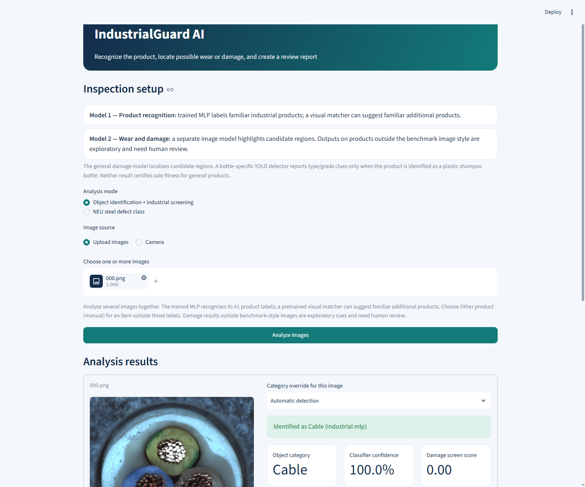
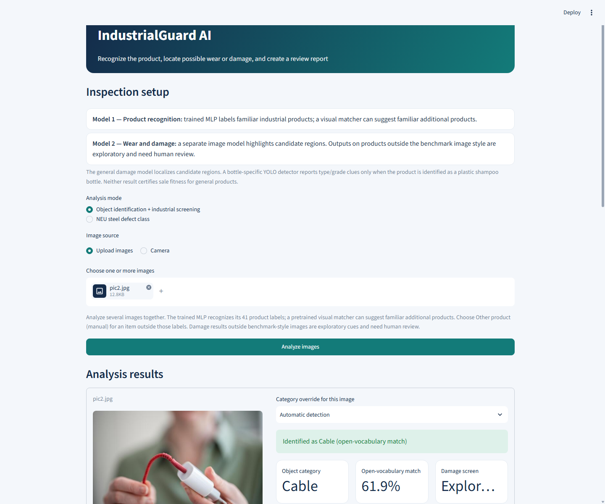

# IndustrialGuard AI — project and evaluation report

**Report date:** 2026-11-02  
**Project:** `D:\ai_project\industrialguard_mlp`  
**Live demo:** [http://127.0.0.1:8765/](http://127.0.0.1:8765/)

## What the project does

IndustrialGuard AI follows a two-stage workflow:

1. **Product recognition:** a 41-label MLP predicts a trained product category. The MLP is trained from scratch using frozen, ImageNet-pretrained ResNet-18 image features. If the trained classifier is uncertain, the app can offer an exploratory OpenCLIP match or let the user select a category manually. Category confidence is kept separate from damage scores.
2. **Wear and damage screening:** a separate ResNet-18 U-Net highlights candidate regions. A MVTec-trained crop head can offer limited broad defect-type clues. For the dedicated `plastic_shampoo_bottle` subtype only, a YOLO11 detector localizes five dataset defect types and their `marginal` / `unacceptable` grades.

The app accepts multiple uploads or a camera photo, waits for the **Analyze images** button, supports manual category overrides, and creates a per-image downloadable report. Its new **Industry focus** control groups manual category choices by sector; automatic classification still checks all 41 product labels. Unsupported people and random-noise examples were rejected without running industrial defect inspection.

## Data used

| Source | Images | Project use |
|---|---:|---|
| MVTec AD | 5,354 | 15 product labels, defect masks, and benchmark evaluation |
| VisA | 10,821 | Product recognition and defect localization |
| Public MVTec AD 2 | 3,914 | Product recognition and defect localization |
| PharmaVision | 640 | Additional pill photos, using its official train/validation/test folders |
| ETID | 6,269 | E-waste category photos; source-group-held-out recognition evaluation only |
| Plastic Shampoo Bottle dataset | 7,907 | Shampoo subtype examples and 28,413 annotated defect boxes |
| NEU-CLS | 1,800 | Separate optional six-class steel-surface mode |

Dataset archive details, checksums, source links, split handling, and license notes are in [data_sources.md](data_sources.md). The product classifier uses 23,118 training and 5,196 validation images across 41 labels. It was selected using validation macro-F1. Its separate benchmark test contains 5,171 images; ETID and shampoo-subtype tests are reported separately.

## Product classification results

- **Validation:** 95.88% accuracy and 96.31% macro-F1 on 5,196 images.
- **Held-out benchmark category test:** 99.63% accuracy and 99.78% macro-F1 on 5,171 images.
- **ETID source-group-held-out test:** 80.0% accuracy and 83.04% macro-F1 on 630 e-waste photos. Cable was correct on 53 of 57 images (92.98%).
- **Shampoo subtype test:** 790 of 790 official held-out images were classified as `plastic_shampoo_bottle`. No false positive was observed among 5,801 held-out images from other available benchmark sources. This is limited to those datasets and does not establish universal out-of-distribution performance.
- **NEU-CLS:** 99.44% accuracy and 99.44% macro-F1 on 360 held-out steel images.

The 41 labels include a separate `bottle` and `plastic_shampoo_bottle`. This separation matters: generic bottles must not automatically be passed to a shampoo-specific defect detector.

## Why and where YOLO is used

The shampoo-bottle dataset has box coordinates plus defect-type and grade labels, so it supports a detector that locates annotated defects. YOLO11n was fine-tuned for 30 epochs at 640-pixel input size on the official train and validation splits; the official test split was held out for evaluation.

| Official bottle test result | Score |
|---|---:|
| Images / defect boxes | 790 / 2,920 |
| Precision | 78.30% |
| Recall | 84.02% |
| mAP@0.5 | 84.32% |
| mAP@0.5:0.95 | 40.91% |

The app displays candidate boxes and maps the dataset’s `marginal` and `unacceptable` labels to minor-like and major-like clues only for `plastic_shampoo_bottle`. A small cross-domain probe found candidates on 6 of 20 normal MVTec glass-bottle photos at confidence 0.25. That probe is not a clean-shampoo validation set; it supports keeping this YOLO route separate from generic bottles and other products.

This source has no clean shampoo-bottle examples. A missing YOLO box does **not** prove a bottle has no damage, and the grades do not certify safety or sale suitability.

## General damage screening results

The ResNet-18 U-Net was trained on 21,060 images, validated on 3,860, and evaluated on 3,076 held-out images. At a threshold selected on validation data, its held-out image-level AUROC was 0.936, sensitivity 82.4%, specificity 97.9%, and F1 88.9%. These are benchmark results, not guarantees on ordinary phone photos.

On 70 MVTec Cable examples (58 normal and 12 defective), image AUROC was 0.893, sensitivity 75.0%, specificity 94.8%, and region IoU 0.247. Candidate localization is imperfect, and a blank or small highlighted region cannot rule out damage.

The broad defect-type head was evaluated on 178 defect crops: accuracy 78.1%, macro-F1 72.2%, and 86.5% coverage at its validation-selected reject thresholds. Its labels are derived from MVTec fault-folder names and are not a universal damage taxonomy. General minor/major severity and fit-for-sale are not trained outputs.

## App verification

- **Streamlit AppTest:** 16 of 16 checks passed. The checks cover normal and defective Cable examples, Capsule, person and random-noise rejection, manual overrides, multiple uploads, ETID Cable routing, automatic shampoo-subtype recognition, YOLO integration and label match, and confirming generic MVTec Bottle does not use shampoo YOLO.
- **Isolated Chrome browser:** 10 of 10 checks passed at the live demo URL, including upload and Analyze flow, Cable/Capsule routing, person rejection, batch upload, manual category selection, automatic shampoo-subtype recognition, and the visible YOLO result.
- **Live server:** returned HTTP 200 at `http://127.0.0.1:8765/`.

The requested `D:\pic2.jpg` charging-cable photo was classified as Cable by the exploratory open-vocabulary route (61.9% match score); the damage screen highlighted candidate regions. Because it is a consumer photo outside the calibrated benchmark style, these highlights need human review and are not confirmed defects.

Screenshots from the live browser run:





Detailed results are saved in [app_regression_test.json](app_regression_test.json), [browser_smoke_test.json](browser_smoke_test.json), [training_metrics.json](training_metrics.json), [bottle_yolo_metrics.json](bottle_yolo_metrics.json), [bottle_yolo_normal_bottle_probe.json](bottle_yolo_normal_bottle_probe.json), and [plastic_shampoo_product_category_test.json](plastic_shampoo_product_category_test.json).

## Limits and next data needed

This is not a detector for every object or every kind of wear. Automatic MLP labels cover a finite set of trained categories; OpenCLIP matches are suggestions, not calibrated probabilities. The app expects one main product per photo and does not reliably locate and classify every object in a crowded scene. OOD checks passed the person and noise examples tested, but a broad benchmark of people, animals, household objects, unseen industrial items, and difficult backgrounds has not been collected.

The general U-Net highlights candidate visual regions; it does not reliably identify every scratch, dent, crack, missing part, or functional defect. Only the shampoo-bottle dataset contains paired defect boxes and minor-like / major-like grades, and it lacks clean examples. To make general sale decisions, the project still needs product-specific normal/defect photos, localized defect labels, reviewed severity grades, and explicit sale/hold outcomes across real cameras, lighting, and viewpoints.

## Main files

- `app.py` — upload/camera UI, category routing, damage overlays, YOLO result display, and downloadable report.
- `src/industrialguard_mlp/train.py` — product MLP training and benchmark metrics.
- `src/industrialguard_mlp/train_bottle_yolo.py` — bottle-only YOLO training.
- `scripts/evaluate_bottle_yolo.py` — official YOLO test evaluation and model report.
- `scripts/evaluate_shampoo_product_category.py` — clean 790-image subtype evaluation and duplicate-excluding data inventory.
- `models/product_mlp.pt`, `models/bottle_defect_yolo.pt` — active product and bottle-defect checkpoints.
- `reports/` — source records, metrics, app/browser checks, screenshots, and this report.

## Run the demo

From `D:\ai_project\industrialguard_mlp`:

```powershell
..\.venv\Scripts\python.exe -m streamlit run app.py --server.port 8765
```

Open `http://127.0.0.1:8765/`, upload one or more product images, and press **Analyze images**. The category selector can override automatic routing for each image.
